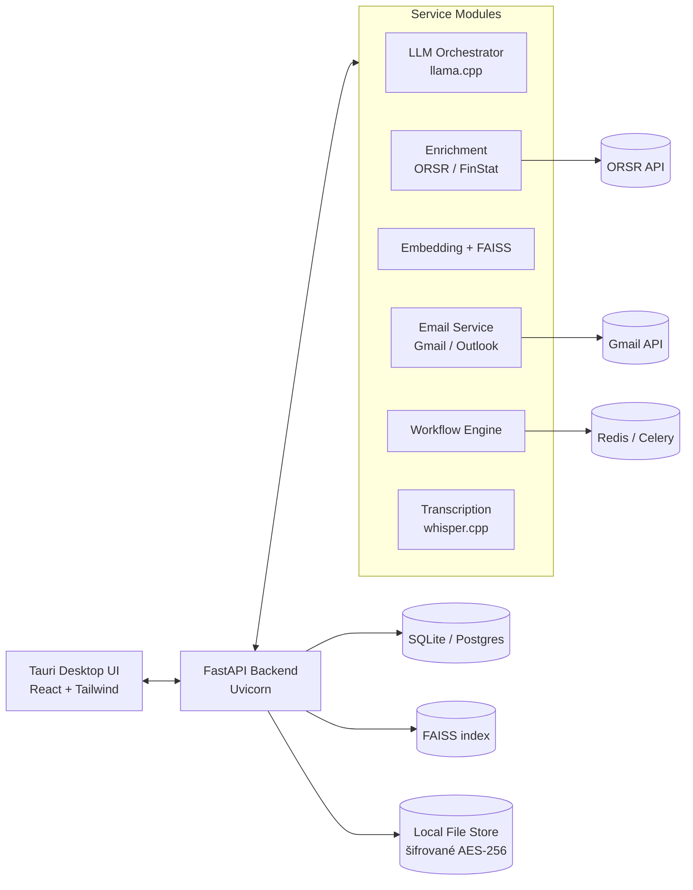

# Architektúra — Super magnet na klientov

Lokálny, modulárny Apollo.io klon pre slovenský B2B trh. Všetka LLM inference
prebieha **lokálne** (llama.cpp / GGUF), externé API (HubSpot, Google, Gmail)
len cez OAuth pre oficiálne integrácie.

## Hardvérový cieľ

| Komponent | Špecifikácia |
|-----------|--------------|
| CPU | AMD Ryzen 5 5600 (6C/12T) |
| RAM | 16 GB |
| GPU | AMD RX 7700 XT (12 GB VRAM) — llama.cpp GPU vrstvy |

Odporúčané modely: 7B Q4_K_M (GPU), fallback 3B (CPU/RAM).

## Vysokoúrovňový diagram



## Komunikačné rozhranie

- **REST + WebSocket** (streaming LLM odpovedí) medzi UI a backendom.
- **Interné RPC** medzi backend modulmi cez HTTP alebo Redis queue (Celery).
- **Bezpečnosť**: JWT auth (Sprint 1), AES-256 šifrovanie DB súborov a nahrávok,
  kľúč uložený lokálne v chránenom konfiguračnom súbore.

## Moduly a priority

| Fáza | Moduly |
|------|--------|
| **MVP (P1)** | Auth, Lead management, Prospecting/Enrichment (ORSR), LLM Orchestrator, Email (Gmail), Export (XLSX/Sheets), Frontend, SQLite, Embeddings+FAISS |
| **Phase 2 (P2)** | Workflow builder, A/B testy, Deliverability checker, Transkripcia (whisper.cpp) |
| **Phase 3 (P3)** | HubSpot/Pipedrive sync, Advanced dashboards, SSO, parallel dialer |

## LLM Orchestrator (pravidlá, §8)

1. **Model selection**: preferuj 7B kvantizovaný; pri nedostatku pamäte 3B;
   pri chýbajúcom GPU spusti llama.cpp na CPU.
2. **RAG**: pri `use_rag` najprv vyhľadaj top-k z FAISS, zostav prompt s
   kontextom (max 2–3 dokumenty), potom generuj.
3. **Prompt templates**: lead scoring, pre-meeting insights, email generation,
   call summarization (parametrizované sloty).
4. **Token management**: sliding window pre dlhé konverzácie; cache výsledkov
   pre identický prompt+context.

## Repozitár

```
backend/        FastAPI + služby + testy
frontend/       React + TypeScript + Tauri
infrastructure/ docker-compose, dev.env
models/         download & quantize skripty
docs/           architektúra, OpenAPI, deployment
```

Podrobnosti o endpointoch: [api_spec.yaml](./api_spec.yaml).
Nasadenie: [deployment.md](./deployment.md).
