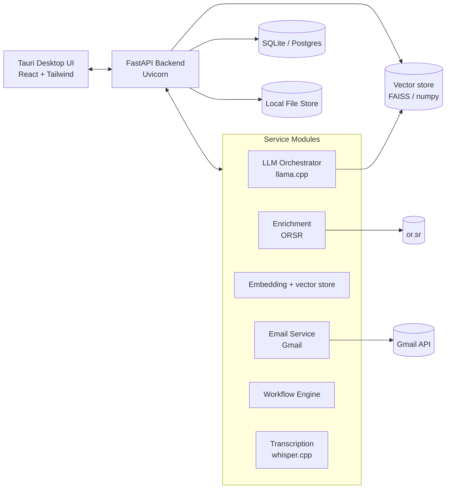

# Architektúra — Super magnet na klientov

Lokálny, modulárny Apollo.io klon pre slovenský B2B trh. Všetka LLM inference
prebieha **lokálne** (llama.cpp / GGUF), externé API (Google, Gmail) len cez OAuth.

## Hardvérový cieľ

| Komponent | Špecifikácia |
|-----------|--------------|
| CPU | AMD Ryzen 5 5600 (6C/12T) |
| RAM | 16 GB |
| GPU | AMD RX 7700 XT (12 GB VRAM) — llama.cpp GPU vrstvy |

Odporúčané modely: 7B Q4_K_M (GPU), fallback 3B (CPU/RAM).

## Vysokoúrovňový diagram



## Komunikačné rozhranie

- **REST** medzi UI a backendom (`/docs` je OpenAPI).
- **Bezpečnosť**: JWT auth (PBKDF2-SHA256 + HS256), `JWT_SECRET` je povinný mimo
  development režimu (aplikácia odmietne naštartovať s placeholder hodnotou),
  CORS len cez explicitný zoznam pôvod, rate limit na prihlásenie, overenie OAuth
  `state` proti CSRF.

## Moduly a priority

| Fáza | Moduly | Stav |
|------|--------|------|
| **MVP (P1)** | Auth (JWT, role), Lead management (CRUD + CSV import + ORSR enrichment + LLM scoring), ORSR connector, LLM Orchestrator (mock fallback + RAG), Embeddings + vektorový store, Gmail/OAuth (sandbox fallback), E-mail sekvencie (enroll/run, A/B), Export (CSV/XLSX/Sheets/Docs), Frontend | ✅ implementované |
| **Phase 2 (P2)** | Workflow builder (vrátane `wait` s pokračovaním), A/B testy sekvencií, Deliverability checker (SPF/DKIM/DMARC), Transkripcia (whisper.cpp) + call insights | ✅ implementované |
| **Phase 3 (P3)** | **Zdroj dát** (Apollo databáza firiem/kontaktov), Celery worker + scheduler pre sekvencie, GDPR (unsubscribe, bounce, suppression list), CRM sync (HubSpot/Pipedrive), audit log, model `Company`/`Contact`, Tauri packaging | 📋 plánované |

### Známe obmedzenia súčasného stavu

- **Sekvencie sa nespúšťajú automaticky.** `POST /api/sequences/{id}/run` sa volá
  ručne; chýba Celery worker a plánovač. Bez toho nie je automatizácia fungujúca.
- **Chýba zdroj dát.** Aplikácia vie importovať CSV, ale nevie nájsť firmy —
  to je jadro Apollo.io a momentálne chýba.
- **GDPR nie je implementované.** Chýba odhlásenie, bounce handling, suppression
  list a súhlas. Pred hromadným posielaním e-mailov to musíš doplniť.
- **ORSR enrichment je heuristický.** or.sr nemá verejné API; názov firmy sa
  parsuje z HTML a pokryjeva všetky slovenské právne formy, nie je to spoľahlivé.
- **Deliverability checker len reportuje.** Nevykonáva žiadnu kontrolu pred
  odoslaním a neblokuje chybné nastavenie.
- **Šifrovanie v pokoji nie je implementované.** `ENCRYPTION_KEY_FILE` je
  v konfigurácii, ale DB ani nahrávky sa nešifrujú.

## LLM Orchestrator (pravidlá, §8)

1. **Model selection**: preferuj 7B kvantizovaný; pri nedostatku pamäte 3B;
   pri chýbajúcom GPU spustí llama.cpp na CPU.
2. **RAG**: pri `use_rag` vyhľadá top-k z vektorového store, zostaví prompt
   s kontextom (max 3 dokumenty), potom generuje.
3. **Prompt templates**: lead scoring, pre-meeting insights, email generation,
   call summarization (parametrizované sloty).
4. **Token management**: cache výsledkov pre identický prompt+kontext
   (ohraničený LRU), sliding window pre dlhé konverzácie.

## Repozitár

```
backend/        FastAPI + služby + testy
frontend/       React + TypeScript + Tauri
.github/        CI (pytest + typecheck/build/lint)
infrastructure/ docker-compose, dev.env
models/         download & quantize skripty
docs/           architektúra, OpenAPI, deployment
```

Podrobnosti o endpointoch: [api_spec.yaml](./api_spec.yaml).
Nasadenie: [deployment.md](./deployment.md).
